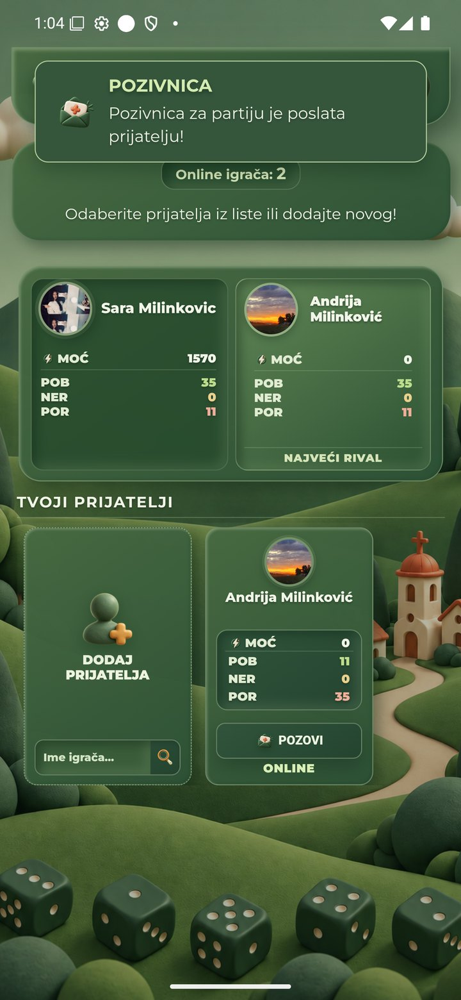
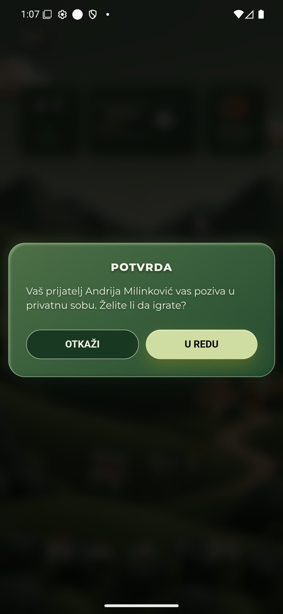
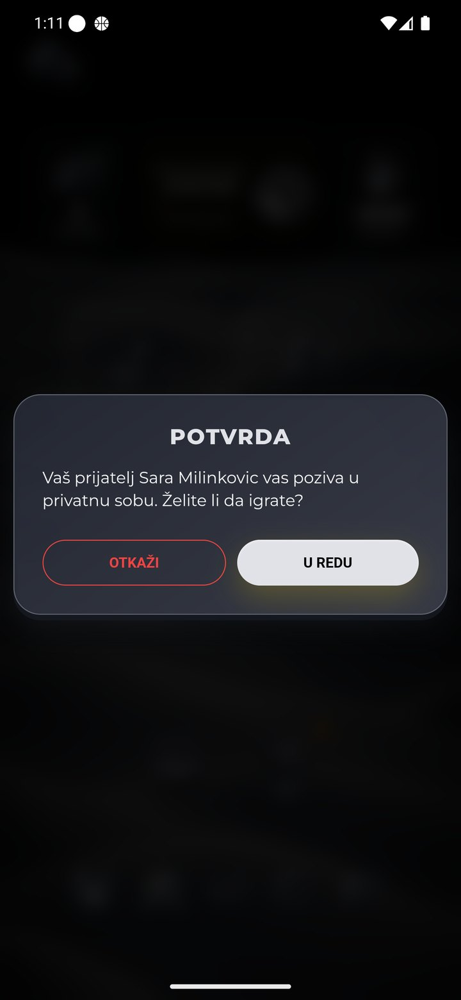
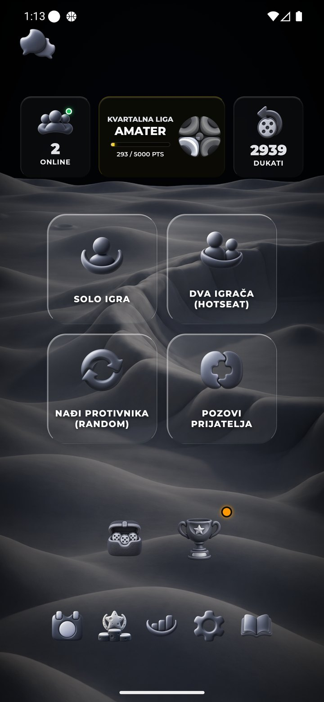
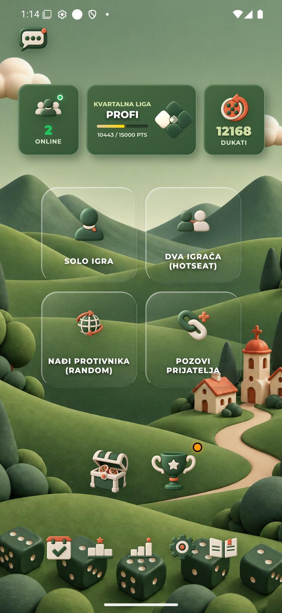

# Poziv prijatelju — prijem posle pokretanja, 1.11.2026.

**R42: pronađen i lokalno ispravljen problem. Nije commitovano ili objavljeno.** Korisnik je ograničio test na poziv, bez ulaska u duel. Nije prihvaćen nijedan stvarni poziv, pokrenuta partija, bacanje, rezultat, reklama, preuzimanje ili revanš.

## Stvarni QA emulatori, objavljena 6.43

| Provera | Rezultat |
| --- | --- |
| Sara → Andrija, posle svežeg otvaranja Andrijine aplikacije | Dve potvrde slanja; modal nije prikazan na pregledanim kadrovima primaoca. |
| Andrija → Sara | Modal primljen; OTKAŽI vraća Saru u meni, bez duela. |
| Sara → Andrija, nakon što je Andrija prethodno otvorio sobu | Modal sada primljen; OTKAŽI vraća Andriju u meni, bez duela. Klijent je i dalje isti objavljeni 6.43. |
| Potvrda odbijanja kod pošiljaoca | Nije uhvaćena na snimcima; ne označavati kao native potvrđenu. Lokalni server/klijent testovi tog događaja prolaze. |
| Završno stanje | Oba glavna menija; nema otvorenog poziva ili prazne sobe domaćina. Salda Andrija2939 / Sara12168 ostala ista. |

Prvi emulator: Moon / Andrija; drugi: Green / Sara. Izvorna geometrija1440×3120/560dpi nije menjana. Ovo nije novi vizuelni pregled svih deset tema niti merenje brzine.

## Uzrok i ispravka

Prijem `incoming_room_invite` i četiri statusna događaja bili su registrovani samo kroz `setupSocketListeners`, koji se naknadno poziva pri otvaranju sobe ili igre. Novi `setupRoomInviteListeners` postavlja iste događaje odmah pri stvaranju socketa. Ponovna postavljanja zadržavaju po jedan handler. Izgled, kanonski PNG, palete, dimenzije, pravila prihvatanja i nagrada ostaju isti.

Nova regresija izvršava stvarni `initSocketConnection` pre bilo kakvog ulaska u sobu: pre ispravke pada zbog nedostajućeg slušača, posle prolazi. Proverava i ponovljenu inicijalizaciju, ponovno postavljanje svih mrežnih slušača, odbijanje bez navigacije/ulaska, zauzetost i tematske statusne ikone.

`npm run check:theme-invite-friend-room` prolazi: mapiranje PNG deset tema, nova startup regresija i postojeća localhost integracija sa sintetičkim klijentima bez Mongo/Firebase podataka. Prihvatanje u tom lokalnom testu nije meč pravih QA naloga.

**Lokalna verzija6.44 čeka kasniju zajedničku objavu.** Snimci ispod prikazuju staru6.43 i potvrđuju reprodukciju, ne Android primenu novog koda. Prihvatanje duela, tehnički ishod, revanš i nagrade isključeni su korisnikovom odlukom i nisu zadaci koje treba ponovo tražiti u ovom koraku.

[Strukturisani rezultat i SHA-256 izvornih snimaka](report.json)

### Poslato, ali bez modala posle svežeg starta

### Prijem u suprotnom smeru

### Prijem nakon prethodnog otvaranja sobe

### Konačni meniji i nepromenjeni saldi

