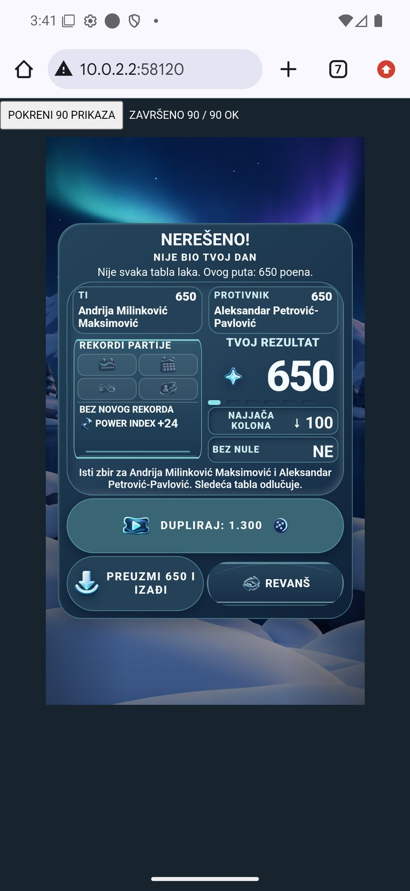
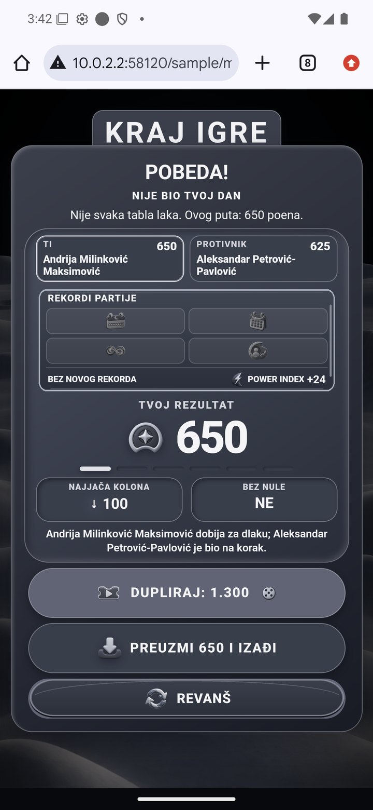
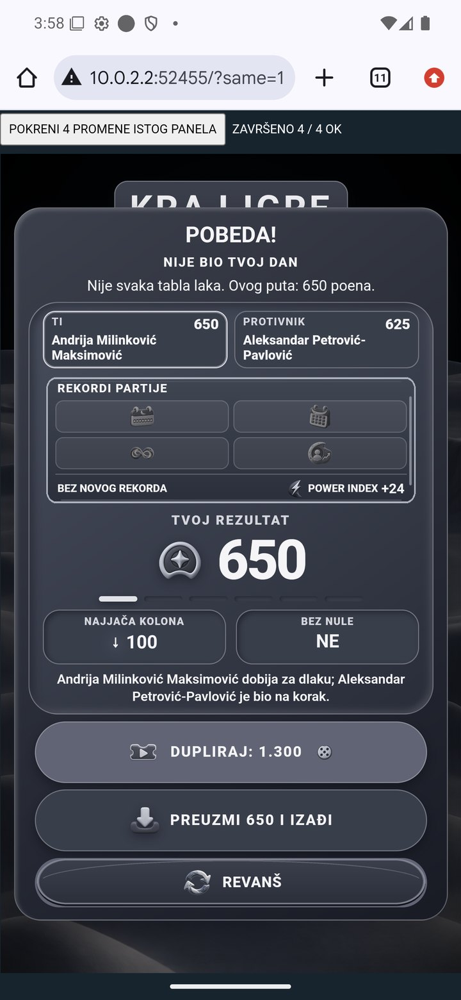

# Završni panel — izolovana Android provera, 1.11.2026.

**Provera sadržaja90/90 i konačna provera promene istog panela4/4 prolaze. Aplikacija nije menjana.** S25 nije povezan; korisnik je izabrao nastavak bez telefona. Ovo je lokalni HTML prikaz u Android Chrome-u, bez naloga, stvarne partije, oglasa ili nagrade. Nije nova završena partija ili dokaz rada SDK isplate.

## Šta je provereno

Stvarni `handleGameOver` iz aplikacije6.44 izvršen je u postojećem izolovanom renderer testu, bez konstruktora aplikacije i pravih mrežnih odgovora. Izvezen je inertni DOM za deset tema i pobedu/poraz/remi. PNG i redosled produkcionih CSS fajlova ostaju isti. Dugmad su neaktivna; događaji igre i nagrada nisu preneti u Android prikaz. Lokalni CSP blokira spoljne zahteve; font može koristiti rezervu.

| Provera | Rezultat i ograničenje |
| --- | --- |
| Deset tema × tri ishoda × tri veličine |90/90 unutrašnjih provera: kartica i sva tri dugmeta u granicama, bez skrola sobe/kartice, bez horizontalnog prelivanja, vidljiviPNG učitani. Veličine411×731,360×640,320×568. Nova navigacija deteta za svaki slučaj; prvi test nije proveravao roditeljski okvir. |
| Isti Moon panel, bez ponovnog učitavanja | Konačni4/4 prolaz:411×731→360×640→320×568→411×731. Proverene i spoljne granice okvira; layout/visual širina roditelja412, scale1, scrollWidth412 u svim koracima. |
| Vizuelno | Stabilni Severna/remi, direktni Moon/pobeda bez iframe-a i konačni Moon posle promene veličine prikazani su celi. Nije sačuvan snimak svakog od90slučajeva. Prelazni prazni kadrovi nisu označeni kao vizuelni uspeh. |
| Povratak u QA | SaraGreen/12168 vraćena u postojeći meni; AndrijaMoon/2939 ostao u meniju. Nema bacanja, upisa, reklama, nagrada ili revanša. |

Emulator5556 zadržava1440×3120/560dpi. Chrome ima412×771/DPR3.5;24px gornje/donje margine su zadate testom. Nisu menjani Android wm/density, app podaci ili keš. Ovo ne potvrđuje Samsung safezone ili ponašanje pravog aplikacionog WebView-a tokom stvarnog rezultata.

## Ispravka samog testnog okvira

Početni test istog panela dao je dobre unutrašnje mere, ali pomeren kadar. Dodatna provera roditelja otkrila je layout širinu434naspram stvarne visual širine412. Ograničavanje zaglavlja nije bilo dovoljno: pri povećanju iframe širine tester je čitao `innerWidth` nakon promene širine, dok je stari levi pomak još ostao. Privremeno prelivanje proširilo je Android Chrome layout viewport i ostavilo okvir pomeren.

Tester sada čuva `visualViewport.width` pre menjanja stilova, najpre vraća levi pomak na0, pa povećava i centrira okvir. Poslednji4/4 uključuje i roditeljske granice i ima stabilan vizuelni snimak. **Ovo je ispravka lokalnog testera, ne aplikacije.** Ranije povremeno odsecanje pravog završnog panela nije ovim uzročno objašnjeno niti proglašeno popravljenim. Ne menjati produkcioni CSS na osnovu ovog problema testera.

## Dokazi

- [Rezime, granice i izvori snimaka](report.json)
- [90unutrašnjih provera](android-1793544032820.json)
- [Početne4unutrašnje mere bez provere roditelja](android-1793544474846.json)
- [3/4uz novu proveru roditelja — neuspeh testnog okvira](android-1793544771397.json)
- [Konačne4/4sa stabilnim roditeljskim granicama](android-1793545040903.json)
- [Kontrolne sume netaknutih produkcionih izvora](sources.json)

Za ponavljanje koristiti `scripts/build-native-finish-fixtures.cjs` sa istim Playwright/Chromium podešavanjima kao postojeći renderer test, pa `scripts/serve-native-finish-probe.cjs`. `?same=1` radi četiri promene istog panela; `--once` zatvara privremeni server posle sačuvanog rezultata. Skripte služe samo lokalnom testiranju, ne učitavaju se u aplikaciji i ne zahtevaju produkcioni deploy.

Preostaju fizičkiS25, prvo učitavanje i stvarni SDK/reward testovi u ranije odobrenim granicama. Prave partije, tehnički ishodi i revanš nisu uključeni u ovu proveru.
