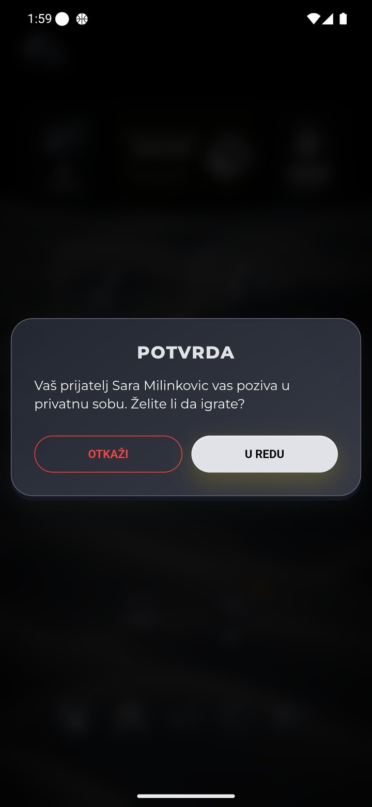
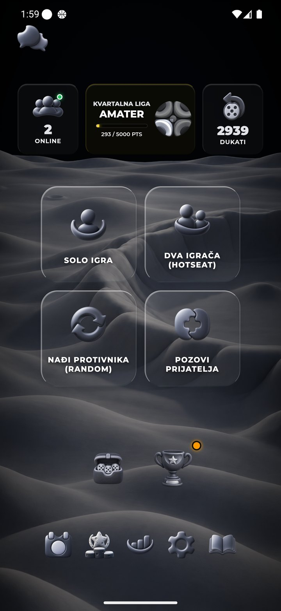
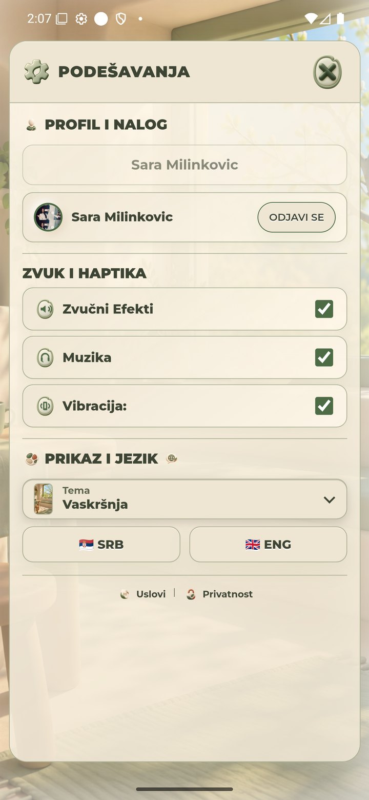
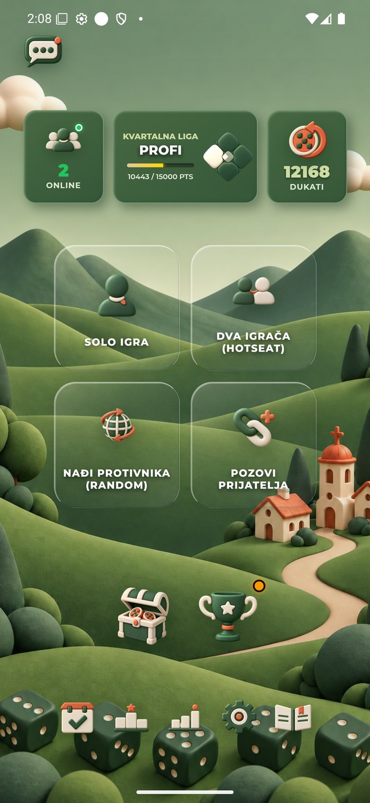

# Potvrda posle objave6.44 — 1.11.2026.

Korisnik je objavio commit `0f48fdcece2a19940ec59a5d0c531b507ab4dcc1`. U ovom nastavku nema nove izmene implementacije, commita ili deploya; sačuvani su samo rezultati provere.

| Provera | Rezultat |
| --- | --- |
| Javni klijent na produkciji i QA | Oba HTTP200, game6.44, normalizovani sadržaj jednak lokalnom. |
| R41 optimizovani PNG | Svih138promenjenihPNG na oba servisa:276/276HTTP200 i identičan očekivaniSHA-256. |
| R42 prijem poziva posle svežeg starta | **Potvrđen.** Obe QA aplikacije ponovo otvorene sa očuvanim podacima. Andrija ostaje samo u glavnom meniju; prvi Sara→Andrija poziv daje modal pre otvaranja bilo koje sobe na primaocu. |
| Odbijanje | OTKAŽI zatvara modal i vraća Andriju u meni. Nije prihvaćen poziv ili pokrenut duel. Pošiljaočev toast odbijanja nije uhvaćen u pregledanom kadru i nije vizuelno potvrđen. |
| Konačno stanje | AndrijaMoon/2939 i SaraGreen/12168, oba menija. Prazna soba domaćina zatvorena. Bez bacanja, upisa, završetka, reklame ili nagrade. |
| Prvi Vaskršnji izbor u novoj app sesiji | Uspešan jednim izborom,28PNGready,0timeout; maxready5928ms, maxload5888ms, maxdecode79ms. |
| Ponovljeni izbor | Green→Easter→Green→Easter→Green uspešno; ponovljeni izbor ne dodaje PNG dijagnostičke događaje72→72. |

Oba emulatora koriste originalnih1440×3120/560dpi. Android ActivityCOLD trajanja8205/9619ms ne predstavljaju vreme spremnosti aplikacije. White/start i intro prelazni kadrovi nisu konačna stanja niti dokaz uzroka ranijih zastoja.

**Granice merenja brzine:** cache je sačuvan, nije urađen kontrolisan hladni mrežni test. Javni hashovi potvrđuju serverove PNG fajlove, ne sadržaj Android keša. Pre kompresije jedna sesija imala je max5111ms, ova5928ms; različiti uslovi ne dokazuju ni ubrzanje ni regresiju. Kompresija od18,45% je objavljena; stvarno trenutno učitavanje/S25 i ranijiANR nisu proglašeni rešenim.

Ne ponavljati već završene osnovne sobe. Preostale granice su hladno/telefonsko učitavanje, povremeno odsecanje završnog panela i fizičkeSDK/reward provere. Prihvatanje stvarnog duela, tehnički rezultat i revanš nisu deo odobrenog testa.

[Strukturisani rezultat](report.json) · [JavniJS](published.json) · [276PNGprovera](published-pngs.json)

## Sveži prijem bez otvaranja sobe na primaocu

## Prvi i ponovljeni izbor teme

